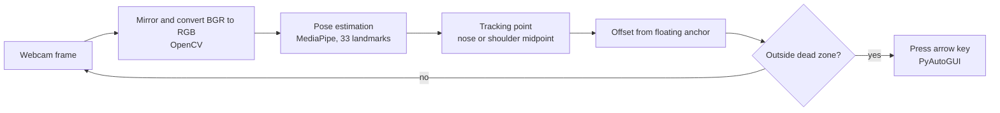

# Subway Surfers: Body-Tracking Gesture Controller

Play Subway Surfers with your body instead of the keyboard. A webcam tracks your pose in real time, and the controller turns your movements into the game's arrow-key presses.

| Your movement | Key pressed | In-game action |
|---|---|---|
| Lean left | `←` | Switch lane left |
| Lean right | `→` | Switch lane right |
| Stand tall / jump | `↑` | Jump |
| Squat / duck | `↓` | Roll |

<!-- Add a demo GIF here: webcam view and game side by side -->
<!--  -->

---

## How it works



1. **Frame processing (OpenCV).** Each webcam frame is mirrored so movements feel natural, then converted from OpenCV's BGR channel order to the RGB order MediaPipe expects.
2. **Pose estimation (MediaPipe).** MediaPipe's lightweight Pose Landmarker model finds 33 body landmarks in the frame. Any landmark with a visibility score below 0.5 is ignored.
3. **Tracking point.** The controller follows a single point: the nose by default, or the midpoint between the shoulders. It converts that point's normalized coordinates into pixel positions.
4. **Floating anchor.** The controller does not compare your position with a fixed spot on the screen. It compares it with an *anchor*: your neutral position. After each move, the anchor re-centers on wherever you are standing. So you can drift around the room and the controls still respond to *relative* movement.
5. **Gesture decision.** If the tracking point moves more than 60 pixels from the anchor horizontally or vertically, the matching arrow key is pressed. Two safeguards stop false or repeated triggers:
   - **Cooldown:** at least 300 ms between key presses.
   - **Return-to-neutral debouncing:** you must come back inside the dead zone before the next gesture can fire, so holding a lean does not spam the key.

### On-screen overlay

- Pose skeleton and the tracking point (blue dot)
- Anchor crosshair and dead-zone box (green when ready, orange during cooldown)
- Cooldown progress bar with READY / COOLDOWN status
- The last action fired

---

## Requirements

- **Windows.** The webcam is opened with DirectShow (`cv2.CAP_DSHOW`).
- Python 3.9 or later, in a version MediaPipe supports
- A webcam
- Subway Surfers running in a browser or on desktop

```bash
pip install opencv-python mediapipe pyautogui
```

The MediaPipe model (`pose_landmarker_lite.task`, about 6 MB) downloads automatically on first run into the script's folder.

---

## Usage

```bash
python subwaySurfers.py
```

1. Stand back so your head and shoulders are clearly in frame, with good lighting in front of you.
2. Hold still for a moment while the anchor locks onto your neutral position.
3. Click the game window so it has keyboard focus. The controller window stays pinned on top so you can watch your tracking.
4. Lean, jump and duck to play.

**To quit:** press `Q` or `Esc` in the controller window.
**Emergency stop:** move your mouse to any screen corner. PyAutoGUI's fail-safe will stop the script.

---

## Configuration

All settings are at the top of `subwaySurfers.py`.

| Setting | Default | What it does |
|---|---|---|
| `LANDMARK_CHOICE` | `"nose"` | Tracking point: `"nose"` or `"shoulders"` (shoulder midpoint, steadier but less responsive to jumps) |
| `THRESHOLD_X` | `60` | Horizontal pixels you must move to trigger left or right |
| `THRESHOLD_Y` | `60` | Vertical pixels you must move to trigger jump or duck |
| `COOLDOWN_SECONDS` | `0.30` | Minimum time between key presses |
| `CAMERA_INDEX` | `0` | Webcam to use (`0` is the default camera) |

**Tuning tips**
- Thresholds are in pixels, so they depend on your webcam's resolution and how far you stand from it. Standing farther back makes your movements smaller on screen, so lower the thresholds.
- If moves fire by accident, raise the thresholds. If you have to exaggerate every move, lower them.

---

## Tech stack

| Component | Role |
|---|---|
| **OpenCV** | Webcam capture, mirroring, BGR-to-RGB conversion, overlay drawing, display window |
| **MediaPipe Tasks (Pose Landmarker Lite)** | 33-point body pose estimation |
| **PyAutoGUI** | Sending arrow-key presses to the game |

---

## Known limitations and next steps

- **Per-frame detection.** The landmarker runs in `IMAGE` mode, so it detects the pose from scratch on every frame. Switching to `VIDEO` mode (`detect_for_video` with timestamps) would track the pose between frames, giving smoother and faster tracking.
- **Windows only.** DirectShow is Windows-specific. Removing `cv2.CAP_DSHOW` should let it run on macOS and Linux.
- **No frame-rate readout yet.** Adding an FPS counter to the overlay would make it easier to measure performance and compare settings.
- **Single player.** Only one pose is tracked (`num_poses=1`).
